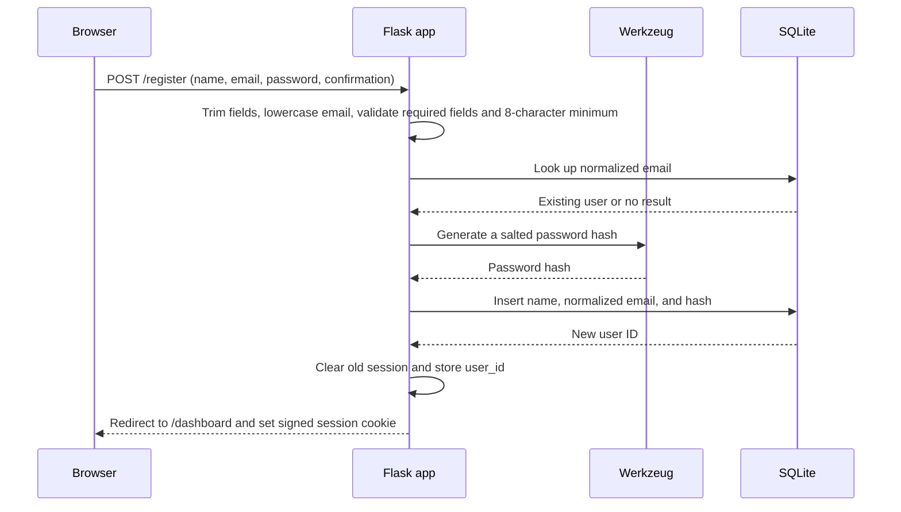

# TalentSouk

## Marrakech public job sources

The daily protected offer refresh now combines Jooble Morocco with public
JobPosting metadata from Postule.ma, JobRadar.ma and MarocEmploi. The latter
three need no API key or account. The import panel exposes each source and
the source filter shows their attribution and links to the full announcements.

Collection reads robots rules, uses an identified TalentSouk user agent,
throttles requests, permits only same-origin HTTPS pages/redirects, and is
bounded to two discovered listing pages, forty detail pages and forty seconds
per source. No login, application form, private API or protection bypass is
used. Full publisher descriptions are not copied into TalentSouk.

An announcement needs a named employer, an absolute datePosted within the
existing thirty-day publication window, and an explicit Marrakech city in its
structured jobLocation. Region-only/ambiguous locations, missing dates,
account emails presented as employer names, and already expired validThrough
dates are excluded. Source URL identity prevents repeat imports of the same
announcement. Original records and personal application references are kept.
Freshness is checked when collected and uses the existing seven-day catalog
verification window; absence from a bounded page is not proof of closure.

Sources run independently. A failure does not stop other Marrakech sources;
the cron reports partial success with failed source names, or HTTP 503 if all
configured domestic sources fail. Source status remains visible in the app.
International/remote adapters remain available in the backend but are outside
this Marrakech-only import schedule and disabled in its source picker.

Initial checked import on November 6, 2026: Postule.ma 20, JobRadar.ma 27,
MarocEmploi 3; the public catalog increased from 181 to 231 records.
Emploi.ma refused the probe with HTTP 403 and was not integrated. Trabajo
remains historical imported data, without a verified direct API connection.

TalentSouk is a local Flask web application for organizing a job search in Marrakech. It combines a company and job directory with a personal application pipeline, lightweight CRM, CV tools, reminders, notifications, and explainable matching helpers.

The application keeps SQLite as its single source of truth and Flask sessions for authentication. Evidence-based local matching remains available, while cover-letter generation and CV advice can optionally use a user-selected Gemini, Groq, or NVIDIA NIM model through server-side API keys.

## What is implemented

- Account registration, login, logout, and protected pages
- A dashboard with application metrics, reminders, and suggested matches
- Searchable company directory, company detail pages, and a company map
- Job and contact APIs backed by imported Marrakech data
- Application tracking with statuses, notes, history, and follow-up reminders
- A CRM view for company and contact follow-up
- In-app notifications and global search
- Candidate profile and career-target settings
- CV upload (`PDF` or `DOCX`, up to 5 MB), view, download, and deletion
- Manual and uploaded CV profiles with selectable templates
- Explainable candidate-to-offer matching and skill-gap analysis
- Local CV keyword optimization that reorders existing skills without inventing experience
- Editable cover-letter generation based only on saved candidate and company data
- A rule-based AI Studio for search, recommendations, matching, and drafting
- Per-user AI provider/model selection in Settings (Gemini, Groq, or NVIDIA NIM)

## Optional AI setup

Create a free developer API key in Google AI Studio and/or Groq Console, then add it to `.env`:

```text
GEMINI_API_KEY=your_server_side_key
GROQ_API_KEY=your_server_side_key
NVIDIA_API_KEY=your_server_side_key
AI_TIMEOUT_SECONDS=30
```

Restart the app, open **Settings → AI settings**, and select a provider and model. Keys are read only by the Flask backend and are never stored in SQLite or sent to browser JavaScript. Free tiers have provider-controlled request and token limits; when no key is configured, the existing local evidence-based features remain active.

## Main components

```text
Browser
  |-- server-rendered pages (Jinja templates)
  |-- JavaScript calls to JSON endpoints
  v
backend/app.py                         Flask routes, sessions, validation, page/API orchestration
  |-- backend/database.py             SQLite schema and user-owned application/CV/profile data
  |-- backend/sqlite_service.py       SQLite directory, dashboard, application, CRM, and AI queries
  |-- backend/companies_data.py       Company access adapter
  |-- backend/matching_service.py     Explainable weighted candidate/offer matching
  |-- backend/skill_gap_data.py       Skill-gap calculations
  |-- backend/cv_optimizer_service.py Local keyword analysis and CV skill ordering
  |-- backend/cover_letter_service.py Local, evidence-based cover-letter drafts
  |-- backend/ai_service.py           Rule-based search, ranking, and recommendations
  v
database.db                   Local SQLite database
uploads/                      User CVs and profile photos (local files)
```

The user interface lives in `frontend/templates/`, with shared navigation in `frontend/templates/components/`. Browser behavior is in `frontend/static/js/`, and styling is in `frontend/static/css/`.

## Authentication

### Components

- `backend/app.py` owns the `/register`, `/login`, and `/logout` routes and the `login_required` decorator.
- `backend/database.py` creates the `users` table and provides user lookup and creation functions.
- Werkzeug hashes and verifies passwords through `generate_password_hash()` and `check_password_hash()`.
- Flask's signed cookie session stores the authenticated user's numeric `user_id`.
- `SECRET_KEY`, loaded from `.env`, signs the session cookie. The app refuses to start when it is missing.
- The global template context resolves the session's user ID to a safe user object containing `id`, `full_name`, `email`, and display initials. It does not expose the password hash.

### Registration request flow



The plaintext password is used only during the request to create the hash. It is not intentionally written to the database or session.

### Login request flow

1. The browser posts the email, password, and optional **Remember me** flag to `/login`.
2. Flask trims and lowercases the email, then loads that user from SQLite using a parameterized query.
3. Werkzeug compares the submitted password with the stored hash.
4. On failure, the app returns the same generic `Incorrect email or password` response for unknown users and wrong passwords.
5. On success, the app clears any prior session, stores only `user_id`, and redirects to `/dashboard`.
6. `login_required` checks for that session value before protected pages and APIs run. Anonymous page requests are redirected to `/login`.
7. `/logout` clears the complete session and redirects to `/login`.

### Credentials, cookies, and tokens

- Passwords are stored as Werkzeug password hashes in `users.password_hash`, never as plaintext.
- SQL user lookups and writes use bound parameters rather than interpolating credentials into SQL.
- The session is a client-side, cryptographically signed Flask cookie. It is signed, not encrypted; therefore only the non-secret user ID is placed in it.
- `SECRET_KEY` is the signing credential. Keep it private, random, stable across restarts, and different in every environment. Changing it invalidates existing sessions.
- **Remember me** makes the session permanent. Its configured lifetime is 30 days. Without it, the session normally ends with the browser session.
- The app does not issue access tokens, refresh tokens, API keys, JWTs, password-reset tokens, or email-verification tokens.
- `.env`, `database.db`, `uploads/`, and Python cache files are excluded by `.gitignore`.

Flask's default cookie protections include `HttpOnly` and `SameSite=Lax`. The application does not currently set `SESSION_COOKIE_SECURE`; production deployments should enable it and serve only over HTTPS.

### User-data isolation

Most personal records are queried or modified with the session user ID as an additional database condition. This includes applications, CV metadata, reminders, notifications, and CV-builder data. Shared company and job directory endpoints are readable without login; user-specific mutation endpoints are decorated with `login_required`.

## Data storage

`backend/database.py` creates and evolves the schema when the application starts. Current data includes:

- users
- companies, offers/jobs, and company contacts
- uploaded CV metadata and CV-builder profiles
- applications and application history
- reminders and notifications
- CRM records

Uploaded files are stored under `uploads/`; the database stores their generated filenames and metadata. Company and job source files are under `data/`, and `backend/import_real_data.py` contains the import workflow. Backup databases are retained under `data/backups/`, while migration SQL files are under `backend/migrations/`.

## Run locally

### Requirements

- Python 3.10 or newer
- A virtual environment is recommended

### Setup

```powershell
python -m venv .venv
.\.venv\Scripts\Activate.ps1
pip install -r requirements.txt
```

Create a `.env` file in the project root:

```dotenv
SECRET_KEY=replace-with-a-long-random-secret
```

Future AI provider settings are read only by `ai_service.py`:

```dotenv
AI_PROVIDER=
AI_API_KEY=
AI_API_BASE_URL=
AI_MODEL=
AI_TIMEOUT_SECONDS=30
```

Evidence-based CV matching and optimization run locally against saved CV data
and real SQLite companies/offers. Grounded cover letters use only saved profile
evidence. Provider-backed CV analysis and skill-gap generation remain unavailable.

To enable Gmail sending, enable the Gmail API in Google Cloud, create an OAuth
2.0 Web application client, and register the exact callback URL configured below:

```dotenv
GOOGLE_OAUTH_CLIENT_ID=
GOOGLE_OAUTH_CLIENT_SECRET=
GOOGLE_OAUTH_REDIRECT_URI=http://localhost:5000/gmail/callback
```

The app requests only `https://www.googleapis.com/auth/gmail.send`. OAuth tokens
are encrypted before SQLite storage; Gmail passwords are never requested or stored.

Generate a suitable secret without printing or committing application data:

```powershell
python -c "import secrets; print(secrets.token_hex(32))"
```

Then start the app:

```powershell
python -m backend.app
```

Open `http://127.0.0.1:5000/register`, create an account, and continue to the dashboard. The SQLite schema is initialized automatically at startup.

## Important current limitations

- The development entry point runs Flask with debug mode enabled; use a production WSGI server and disable debug mode for deployment.
- There is no CSRF protection on HTML forms or JSON mutation endpoints yet.
- Logout is currently a `GET` request; it should become a CSRF-protected `POST` action.
- There is no rate limiting or temporary lockout for repeated login attempts.
- Password reset, email verification, multi-factor authentication, session revocation, and account deletion are not implemented.
- Cookie security settings are not explicitly hardened for HTTPS production use.
- The AI-labelled features are explainable local rules, not generative AI calls.
- Focused Flask integration tests cover Apply, user isolation, dashboard counts,
  directory APIs, CRM ownership, authenticated pages, and local AI/CV helpers.

## Production hardening checklist

Before exposing the app publicly:

1. Run it behind HTTPS with a production WSGI server.
2. Disable Flask debug mode.
3. Set `SESSION_COOKIE_SECURE=True`, retain `HttpOnly`, and choose an appropriate `SameSite` policy.
4. Add CSRF protection and change logout to `POST`.
5. Add login throttling, security logging, and generic error handling.
6. Validate ownership in every user-specific service operation and add authorization tests.
7. Keep `.env`, SQLite databases, uploaded CVs, and backups outside source control and protect filesystem permissions.
8. Add malware/content scanning and stronger validation for uploaded documents.
9. Add database backups, retention rules, and a documented deletion/export process for personal data.

## Repository notes

`backend/legacy/database_before_real_data.py` and the pre-migration databases in `data/backups/` are historical snapshots rather than active runtime modules. Runtime reads and writes go through `backend/database.py` and `backend/sqlite_service.py`.


### Interview simulator and AI routing

Select an offer in Interview Helper to practice immediately, or start from a scheduled interview. NVIDIA Kimi generates HR, technical and behavioral questions and evaluates clarity, organization, relevance and STAR. Results and weak skills are saved privately and feed separate technical and soft-skills roadmaps. Local practice indicators are explicitly labeled if the provider fails; text feedback does not evaluate voice, gestures or personality.

Server environment variables: `NVIDIA_API_KEY` for interviews, `XAI_API_KEY` for Grok matching, `GEMINI_API_KEY` for CV summaries, messages, WhatsApp and cover letters. Grok and Groq are separate providers. Optional model overrides: `NVIDIA_INTERVIEW_MODEL`, `XAI_MATCHING_MODEL`, `GEMINI_GENERATION_MODEL`. See `.env.example`. No API keys are exposed to the browser.

Verification: `python -m unittest backend.tests.test_interview_simulator backend.tests.test_ai_service backend.tests.test_ui_repairs`.


### Phase 1: reliable scores, statuses and market updates

- Interview fallback scores are capped local practice indicators based on vocabulary diversity, sentence structure and question-term overlap. They are explicitly labeled and do not establish technical mastery. AI coaching uses the returned clarity/structure/relevance/STAR rubric; empty answers always receive zero.
- CV before/after indicators apply the same formula independently: 65% documented job alignment, 25% section completeness and 10% whitespace/punctuation consistency. Reordering skills alone can leave the score unchanged. These are not recruiter ATS scores or hiring probabilities.
- Applications, CRM and Dashboard share canonical states: Wishlist, Draft, Sent, Replied, Interview, Accepted, Rejected. Legacy Applied/Contacted are conservatively displayed as Draft; they are not proof of sending. Outreach Sent maps to Sent, Reply Received to Replied, Interview Scheduled to Interview and Offer Received to Accepted. Funnel counts represent reached stages; rejected applications do not imply a prior reply.
- Run CSV updates with `python -m backend.import_real_data`. The import preserves existing company/offer IDs, references and rows absent from a batch. It retains existing values when incoming fields are empty, uses a SQLite snapshot backup and foreign-key validation, and aborts ambiguous identity matches instead of merging them. Importing the Python module itself never starts an import. This is incremental CSV maintenance, not a scheduled Opportunity Radar.
- Development dependencies: `python -m pip install -r requirements-dev.txt`. Full checks: `python -m unittest discover -s backend/tests`. Import tests use temporary databases and never run the CSV import against the user's live database.


### Phase 2 — Career DNA

Open `/career-dna` from the tools menu. It combines the created CV, uploaded CV,
reviewable document extraction and account identity. Created CV fields take
priority over uploaded fields; explicit Career DNA corrections take priority over both.
Unmodified fields track later CV updates. Originals are preserved, and corrections
or reviews can be reset independently. Skills detected only from raw extraction
require confirmation before inclusion. Documented skills represent profile statements,
not proficiency assessments. Goals and desired skills are separate from existing skills.

The shared profile is the default for recommendations, skill-gap analysis, matching,
interview questions and AI application drafts. Explicit saved-CV comparisons remain
available in Studio and Skill Gap; Studio optimization and cover letters also accept
Career DNA. Excluded skills are filtered out of the shared factual sections, so an
old raw CV cannot silently reintroduce them. Preferred location is stored separately
from current location and used as the matching location preference.

Career suggestions come from existing offers with matching included skills, without
restricting the target job title. Each suggestion shows overlap and missing requirements;
it is not a claim of readiness or a hiring probability. No external AI call is required
to view or review Career DNA. Corrections and reviews are stored per user in
`career_dna_profiles`, with account deletion cascading to this table.

Validation: `python -m unittest discover -s backend/tests` includes isolated Career DNA
coverage for provenance, goals, pending skills, corrections, exclusions, resets, account
isolation, shared tools and career suggestions.


### Phase 3 — Interview practice and actionable skill gaps

Interview Simulator adds a beginner guide, per-question frameworks, an editable
practice draft and explanations for each suggested change. NVIDIA Kimi can return a
grounded rewrite; invalid optional rewrites fall back to a guided outline containing
the original answer. New numbers and recognized technologies absent from the answer
are rejected. All suggested drafts remain reviewable: check claims before using them.
Local STAR indicators require content in each section; labels/placeholders alone are
not evidence. Local indicators remain capped at 65 and do not assess correctness.
The fallback question set consistently contains 2 HR, 3 technical and 2 behavioral questions.

Completed practices cannot be overwritten. Repeat same questions creates a separate
owned attempt. Comparison requires identical questions, company/role, mode, scoring
engine and rubric. Older history remains visible but scores without metadata are not
compared. The latest completed practice per company/role supplies current interview
practice focuses, so old feedback does not permanently penalize improved attempts.

Skill Gap can target a single real offer or a market. Targeted analysis includes
unrecognized short requirement labels as well as the known skill catalog and excludes
unrelated offers/companies. Roadmaps have concrete exercises, project validation and
separate technical/soft-skill learning actions. Each action has private, reversible
planned/in-progress/completed state and evidence notes. Completion is self-reported;
it does not certify skill mastery or automatically change Career DNA.

Learning links verified against primary documentation: Python tutorial
(https://docs.python.org/3/tutorial/; assumes basic programming), SQLite SQL reference
(https://www.sqlite.org/lang.html), React Quick Start (https://react.dev/learn), and MDN
web learning (https://developer.mozilla.org/en-US/docs/Learn_web_development).
Other skills include a local project-validation checklist; soft skills link to STAR practice.

Tests: `python -m unittest backend.tests.test_phase3_coaching` covers safe optional
rewrites, STAR evidence, question mix, offer targeting, repeat ownership, persistence,
completion immutability, comparable progress and rendered JavaScript syntax.

### Existing-feature UX and navigation

AI Studio separates CV tailoring, company matching and cover letters into tabs.
Career DNA separates profile edits, skill review, goals and career paths. Hash
links open the corresponding tab; keyboard arrows, Home and End navigate tabs.
Each company offer links directly to application preparation, CV tailoring,
skill analysis and interview practice. Studio and interview feedback retain
the selected offer when opening the next tool. Main pages include a career
journey navigation, and Dashboard exposes profile, learning and practice.
Interview practice also accepts an external job title with optional description
and multiple selected skills, without creating a catalogue offer.

Navigation regression checks render the main pages and follow their local links
in an isolated database. Browser checks use a synthetic profile, not live user data.

### Interface visual refresh

A shared `ui-polish.css` layer loads after page styles to unify neutral surfaces,
brand colors, readable forms, lighter buttons, focus indicators and mobile layouts.
Dashboard offers three intent-based starting points. Next-step navigation displays
two relevant actions and keeps the complete journey in a disclosure. Mobile search
and language selection remain visible. RTL sidebar positioning and reduced-motion
preferences are supported. Existing data and service routing remain unchanged.

### Task 4.1 — saved optimized CV versions

Every successful optimization stores an immutable, user-owned snapshot in
`cv_versions` in the same transaction as updating the latest optimized CV.
The original manual/uploaded profiles remain unchanged. Schema initialization
imports the previously saved latest optimization once, marked as legacy; it
cannot recover versions that had already been overwritten before this feature.
AI Studio links to `/cv-versions`; each snapshot can be viewed and downloaded
as HTML. The existing print view exports PDF through the browser's Save as PDF
workflow. New export links refer to a specific version ID rather than whichever
CV was optimized most recently. All reads are scoped to the logged-in owner.
Before/After change explanations and application-version linking remain separate
future tasks. Validation: `python -m unittest backend.tests.test_cv_versions`.

### Task 4.2 — actual Before/After content

New optimized CV snapshots retain the source structured profile and the exact
field changes with explanations. Summary normalization and generation are included
in the actual exported profile and the after score. Saved comparisons never read
the current source CV, which may have changed later. Versions created before this
feature explicitly report that their original snapshot is unavailable. Applied
changes are separate from suggested improvements.

### Task 4.3 — candidature CV version linkage

Postulations can select an owned saved CV version, or open directly from the
versions page with that CV selected. The draft retains `version:<id>` in its
existing `cv_used` field. Letter generation and Gmail attachments read that
immutable snapshot, not the latest optimization. Applications links to its
saved version. New drafts selecting the latest optimized CV resolve its version
ID at save time. Drafts can be revised; progressed applications cannot have their
CV overwritten through the postulation upsert. Existing manual/uploaded sources
remain available and are not retroactively assigned a fabricated version ID.
The existing structured-CV attachment format remains UTF-8 text. Browser PDF
export is available from the linked saved version. Tests cover immutable content,
foreign-version rejection, letter evidence and prevention of replacing sent CVs.


### Opportunity Radar (5.1)

`/opportunity-radar` lists existing SQLite offers with search, source/location/contract filters and pagination. Cards link to the exact company and offer in application preparation; original links accept only HTTP(S). The sidebar and career journey expose this page.

Refresh offers reads the bundled `data/all_jobs_marrakech (2).csv`; it does not fetch live websites. The CSV adapter uses MarketSync in one transaction, preserves IDs and personal references, skips deletion, and rolls back on invalid/ambiguous rows. Metadata separately records first observation and last check in UTC; old offers show “Not recorded” until checked. Last checked means checked against the local file, not confirmed active on the website. Repeated rows are merged by exact source URL when present; distinct URLs remain separate announcements. Without a URL, the existing posting identity rules apply. Ambiguous pre-existing duplicates require review rather than destructive merging. External adapters and personal alerts are later steps.


### Opportunity Radar external sources (5.2)

The import panel supports local CSV, Jooble Morocco, Adzuna (France, UK, Germany, USA) and Arbeitnow Germany. Server credentials: JOOBLE_API_KEY (issued on ma.jooble.org), ADZUNA_APP_ID and ADZUNA_APP_KEY. Missing keys disable the corresponding UI choices. Arbeitnow requires no key. No secrets are returned in UI or logged in provider failure messages.

Imports are bounded: Jooble first results page, Adzuna up to 50 results, Arbeitnow latest feed page (up to 100), with keyword/city filtering applied locally for Arbeitnow. A refresh is not a full market crawl. Fetching and validation happen before the transactional sync. Companies are linked by unambiguous normalized name or created; applications and saved CV references remain intact. Each successful refresh records source/country and counts. Empty searches keep existing offers. Imports remain manual; scheduled refresh and personal notifications are not implemented here. Jooble/Adzuna need valid configured accounts for live verification.

Jobicy: no-key public remote job feed added to Radar; import the latest up to 100 jobs, filter keywords/regions locally, preserve Jobicy attribution and canonical URL. Remote — Worldwide describes the feed; each listing retains its actual geographic eligibility. Public responses are cached for one hour per local database. Trabajo remains a local imported source, without a confirmed direct API.


### Automatic Radar and matching notifications

Running `python -m backend.app` starts a daemon that checks every hour while the app is running (RADAR_AUTO_SYNC=0 disables it). SQLite leases prevent concurrent/restart duplicates and expire after a crash. Each source failure is isolated and shown in Radar status. APIs are polled for bounded recent result pages; no webhook or instant/full-market coverage is promised. Jobicy and Arbeitnow global feeds, Jooble Morocco and Adzuna France are queried. Up to three additional distinct user target-role/location queries for Jooble rotate hourly. Existing country restrictions remain in effect; these extra queries use the Morocco key.

Newly inserted offers notify users with enabled notification preferences only when their target job or career field matches; no CV is transmitted for matching. Matching is local and explained in the message. Duplicate user/offer notifications are suppressed atomically. Profile goals can be edited from Radar. Notification links and offer cards open a detail page connecting that exact offer to Skill Gap, Interview Simulator, AI Studio and application preparation. Existing saved offers do not trigger retroactive notifications.


### Career Copilot — weekly planning

Open `/career-copilot` from Tools and choose Create my weekly plan. The current version uses explainable local rules, not an AI provider call. It reads saved goals, unified Career DNA, existing applications, current offers and reminders. Every task has a reason and a link to the relevant tool with offer context where available. Matching target titles take priority over broader domain matches; location is an additional preference, not an eligibility guarantee.

Weekly plans, edits, custom tasks and completion are persisted per account. Update suggestions adds nonduplicate tasks without resetting completed or edited tasks. Users mark completion explicitly; tool visits never count as completed work. New weeks are created on request; past plans remain in My saved weeks. There is no automatic application or message sending.


### Proof-of-Skills Portfolio

Open `/portfolio` from Tools, or Build a proof project in a Skill Gap roadmap. Choose a skill to preview a predefined project template and start it. The private per-account workspace saves checklist steps, an HTTP(S) evidence link, a contribution summary and validation notes. Starting the same skill for the same offer reopens the existing project. Offer context remains linked to Radar and Skill Gap.

Completion is explicitly self-reported and requires all checklist steps, evidence and a contribution summary. Links are not fetched or reviewed. Download README template provides a Markdown checklist and documentation prompts. Add this project to my editable CV explicitly appends the actual title, saved contribution and link to Projects in the editable CV and unified Career DNA, preserving existing content and the original uploaded CV. The export is idempotent; subsequent project changes do not update the saved CV entry. Copilot proposes continuing unfinished proof projects. No skill certification or external publishing is performed.


### Company 360° and Networking

Company details now group offer records, recurring skill mentions, offer source/publication/last-check metadata, private linked professional contacts, networking activity and application follow-ups. Skills are counted from saved offer text; they are not verified company-wide requirements. Missing metadata remains explicitly unavailable.

Open Networking to save professional contacts, their source, role, linked company, private notes and next follow-up. Record conversations with date/channel/direction/outcome. FR/EN introduction and follow-up drafts are editable and copied locally; the app never sends them. Archive is reversible. Contacts and interactions are scoped to the signed-in account and are removed with account deletion.

The local background loop checks due networking follow-ups every minute and creates one in-app notification per contact/due date, respecting disabled notification preferences. Clear or change the follow-up date after taking action. Copilot can suggest a due networking follow-up when updating weekly suggestions.


### Performance Lab and offer comparison

Performance Lab reads only the signed-in user's application records and status history. It shows current status distribution, recorded milestones, monthly sending cohorts, company fields and owned saved CV versions. Legacy Applied maps to Draft. Recorded sent/advanced states or applied_at establish a sent record; these are saved user records, not independent delivery verification. Outcome includes reply, interview, acceptance or rejection. Interviews require an explicit current/history status; acceptance does not invent an interview. Invalid or missing sending dates are excluded from monthly cohorts and disclosed. Outcomes are observed to date, not a fixed response window. CV groups below five sent records are labeled small samples; descriptive differences never prove causal CV performance.


### Career Quest and Digital Twin

Career Quest derives seven milestones from per-account saved actions: career direction, saved CV version, completed interview with answers, completed proof project with evidence, three documented learning actions for one skill, an active professional contact with a recorded conversation, and three completed suggested tasks for the current week. Each milestone contributes XP once. XP is recalculated, not permanently awarded; undoing completion or moving to a new week can reduce points. Custom tasks do not earn XP. No artificial activity streak or skill-certification claim is displayed.

Digital Twin compares current documented skill mentions with up to six explicitly hypothetical skills against up to 60 saved offers, displaying up to ten results. It models only catalog skill mentions; it does not model hiring probability, salary, experience level, geography or proficiency. Missing offer skill data yields no calculated coverage. An already documented skill adds no hypothetical gain. Scenarios are saved privately with assumed skills and selected offer IDs, then recalculated using current profile evidence and current saved offer text. Saving never adds assumed skills to Career DNA or a CV. Portfolio links let users practice and document evidence separately.


### Interview voice dictation

Each practice answer offers optional browser speech recognition with French, English and Arabic (Morocco) selection. Microphone access starts only after clicking Dictate. Browser support and Arabic/Darija accuracy vary. The browser may process audio through its own speech service; TalentSouk does not record or store audio. Only finalized transcription appends to the editable answer, and only reviewed text is submitted through the existing feedback flow. Navigation, submission and manual typing stop recognition; stale callbacks cannot write to another question. Unsupported browsers and denied microphone access retain the typed-answer workflow. This feature does not evaluate voice, accent, emotion or delivery.

Verification: `node backend/tests/interview_voice.test.cjs` covers unsupported browsers, finalized text preservation, stale callbacks, microphone denial and length limits.


### Skill Practice

Open `/skill-practice` from Skill Gap or See all tools. The introductory question catalog includes SQL, Python, Git and Communication. Each exercise has three questions with deterministic scoring and explanations. Communication checks principles in hypothetical situations, not observed behavior. Scores describe only these questions; retakes use the same items and do not establish proficiency or certification.

Attempts are versioned, private to the account, and deleted with account deletion. Submitting saves only the exercise answers and result; CV evidence and Career DNA remain unchanged. Result pages link to learning roadmaps and a proof project for the selected skill. Skills outside this small catalog remain available through the existing learning and portfolio flow.


Digital Twin page removed at user request. Its route, template and all navigation links are removed. Existing private scenario storage is retained and continues to cascade on account deletion.


### Email ownership verification

Login and registration use a logo-inspired arch form. New accounts and unverified accounts on password login must confirm their email with a one-time eight-character code before entering the app. Changing the account email invalidates verification. Codes expire after ten minutes, allow five attempts, and resend is limited to once per minute and five deliveries per hour. Only code hashes are stored.

Delivery uses the existing SMTP_HOST, SMTP_PORT, SMTP_USER, SMTP_PASSWORD, SMTP_FROM_NAME and SMTP_USE_TLS configuration. Delivery failures are shown without authenticating the account or exposing the code. Existing sessions are asked to verify on their next password login. Verification tests mock delivery and do not send email.


### Branded notification email and application message drafts

The Postulations form can generate an editable AI application message from the selected account-owned CV, company and published offer (or spontaneous target position), in English, French or Arabic. Generation does not send an application.

New in-app notifications are queued atomically through a SQLite trigger, including Radar matches and Networking follow-ups. The local background worker checks mail every minute while the server runs, even with RADAR_AUTO_SYNC=0. Delivery requires a verified current email, enabled email notifications and SMTP. Instant sends on the next check; daily/weekly group updates since the previous successful delivery, with the first group eligible immediately. Existing notifications are not backfilled. Pending items older than seven days expire; disabled preferences discard pending mail. Failed SMTP delivery retries after fifteen minutes, up to five attempts. Delivery records prevent ordinary repeat sends, though an SMTP acceptance followed by a process crash can cause a retry duplicate.

Account verification, password reset and notification mail use the TalentSouk logo embedded as an inline image, a named source page, plain-text fallback and links. Set APP_BASE_URL to the app's public HTTPS address when deployed; its local default is http://127.0.0.1:8000 (links open only on the computer running the server). The worker batches at most fifty notifications per user and ten user deliveries per check. Tests mock SMTP and AI; no real mail is sent by the tests.


### Application delivery before saving

Final Preview resolves available delivery channels from the selected saved company and offer, after validating the user-owned CV. Gmail displays the actual recipient and requires the user's final confirmation; it first persists the reviewed draft, then uses the existing Gmail send route with selected CV and cover-letter attachments. Failed sends retain that draft for retry. Connect Gmail saves the draft before OAuth and returns to Applications. WhatsApp pre-fills the reviewed message for manual sending, and the original offer link opens the source website; neither automatically changes application status or attaches a CV. Missing contacts are not invented. Original links accept only HTTP(S); WhatsApp requires a usable international number (Moroccan local numbers are normalized only for explicitly Moroccan company locations).


### Morocco company catalog

Companies now displays records with Moroccan location, coordinates or an official .ma website as geographic evidence; original foreign and unknown-location records remain stored for existing applications and tools. Official HTTP(S) company sites sort first. Social networks, maps, job aggregators and placeholder strings are not shown as official company sites. The source filter is populated from saved offer sources and directory origins, and supports multiple sources per company. Technology specialties derive from company name, category, description, website and linked job titles/requirements. They are searchable tags, not a verified company-sector classification. Display normalization trims whitespace and removes null placeholders without modifying original IDs or saved data.

Companies and imported opportunities are limited to Morocco. Foreign catalog records were removed after a SQLite backup; personal application and interview history is retained. The Compare offers page has been removed.

Interface language is saved per account (English, French, Arabic); visitors keep their choice in a validated cookie. All pages share an offline translation catalogue. Language changes preserve form input, update dynamic interface text, dialogs and chart labels, and enable RTL for Arabic. Imported offers, company names and user documents are not rewritten. Interface coverage and placeholder preservation are checked in test_interface_language.

Networking, Career DNA and Career Quest pages have been removed. Profile links use /profile. Saved candidate evidence continues to power CV, matching and interview features; historical networking data is retained but no longer generates follow-up alerts.


### Reminder and product-update notifications

The notification worker starts on the first server request (including WSGI deployments), or when running `python -m backend.app`. Keep the server running for background delivery; `NOTIFICATION_WORKER=0` disables automatic startup on requests. Job synchronization and notification delivery use separate threads, so slow or failed job sources do not block email. Due application reminders create one alert each, including overdue reminders, with a durable application-history marker to prevent repeats after the bell is cleared. Polling the bell also checks the signed-in user's due application reminders. Email preferences apply to mail delivery; reminders remain available in the app.

To announce an actual product update to all current users, run once from the project directory:

```powershell
python -m backend.notification_events --title "New feature available" --message "Describe the change here." --url /dashboard
```

This creates in-app alerts and queues email using the existing verified-email and frequency settings. Identical announcements are skipped while their notifications remain saved; clearing them allows an operator to republish the same announcement. There is no public broadcast endpoint. Do not publish placeholder announcements. SMTP must be configured and the user's current email verified for delivery.


### CV Studio

CV Builder now has a focused section editor with completion tracking, a live preview, template selection and browser PDF export (choose Save as PDF in the print dialog). The Create with AI phase combines the current unsaved profile with a user-written career story and calls the configured AI provider. Generated text is validated and shown for review; applying a draft changes only the editor. The existing Save CV action persists it through the existing profile storage, including Supabase when selected. Contact details are preserved locally and are not included in the generation prompt. English, French and Arabic drafts are supported. AI generation requires a configured provider; no draft is fabricated when the provider is unavailable.

## Account appearance

Users can choose Royal Plum, Lavender Bloom or Atlas Blue, with Light, Dark or device-controlled mode. The optional `/personalize` step follows the career questionnaire; Profile and Settings also expose the picker. Uploaded photos are optional and selecting an avatar preserves the stored photo.

SQLite adds `user_settings.appearance_json` during initialization. For an existing PostgreSQL deployment, run `python scripts/migrate_appearance.py` before starting the updated application. This additive migration preserves existing account preferences. New schema exports should be generated from an initialized SQLite database.

## AI Portrait Studio

CV Builder includes an optional photo-to-professional-portrait flow using the existing server-side `GEMINI_API_KEY`. Set `GEMINI_PORTRAIT_MODEL` (default `gemini-nano-banana-2.1`) to an image-editing model available to that API account. The account needs sufficient image-generation quota. The request format follows Google's [image editing documentation](https://ai.google.dev/gemini-api/docs/generate-content/image-generation).

The user chooses a source photo, a style and consent before generation. Source files are not saved by TalentSouk. Generated files and gallery metadata are private under `STORAGE_ROOT/uploads/portraits/user<id>/`; include this directory in persistent storage and backups when deploying. Users may select a result for their CV, app profile, or both, and download it. Selecting an app-profile portrait preserves the current CV photo. The Minimal CV template continues to omit photos. No database migration is required for this feature.

Generation is serialized per account with a six-successful-portraits-per-UTC-day limit. The gallery shows the latest 24 portraits. Provider failures return an actionable message; no fallback image is presented as AI-generated. Account deletion removes the user's portrait directory after checking its resolved parent path.

## Guided onboarding and company domains

After the questionnaire and optional appearance customization, new users reach `/getting-started`. They can start or skip an eight-step guided tour. Account-scoped progress (running, skipped, completed and current step) is stored inside the existing `user_settings.appearance_json`; saving appearance or notification preferences preserves it. Settings → General → Open tutorial allows resuming or replaying. Tour navigation never sends an application or starts AI generation. Consecutive steps within CV Builder update the guide without reloading the editor.

Company domains now include `Génie civil` and `Construction / BTP`. These labels are inferred from existing company names, categories, descriptions, websites and linked offer evidence without rewriting original categories or IDs. The Companies directory supports these domain filters and sector-first sorting; AI Studio, CRM and grouped company selectors share the same classification. Career market selectors also include the two domains. Empty sectors do not create or invent company records.

### Free Photo Studio
CV Builder defaults to browser-based photo enhancement (square framing, zoom, vertical positioning, brightness and a subtle border). It preserves the original background and does not use an AI provider. Only the saved result is uploaded to the private portrait gallery; CV/profile selection and download use the existing owner-scoped routes. The optional AI mode still requires Gemini image credits and explicit provider consent. Both modes share the existing six-per-day storage limit. No new service, key or dependency is required for free mode.

## Free hosting storage and email

Render Free uses private Supabase Storage with UPLOAD_STORAGE=supabase, SUPABASE_URL, SUPABASE_STORAGE_BUCKET and the server-only SUPABASE_STORAGE_KEY. Existing authenticated download routes hydrate a disposable local cache. Local file mode remains the default outside deployment. Keep the bucket private and migrate existing uploads before launch. See DEPLOYMENT.md.

For free hosts that block SMTP, EMAIL_PROVIDER=brevo, BREVO_API_KEY and a verified BREVO_SENDER_EMAIL enable HTTPS transactional delivery. Existing SMTP remains available in local mode. Free hosting sleeps on idle, so background notifications are not continuously scheduled. No paid plan is enabled automatically.
